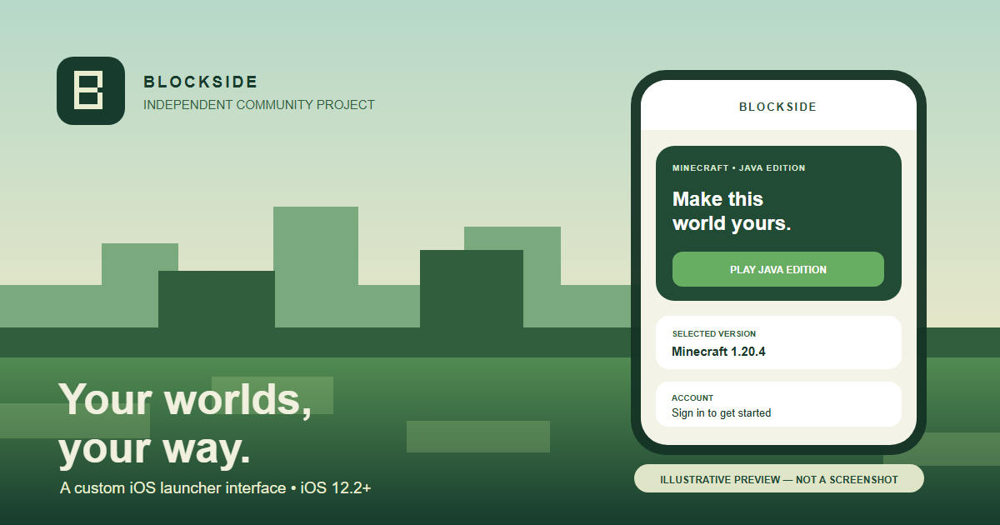
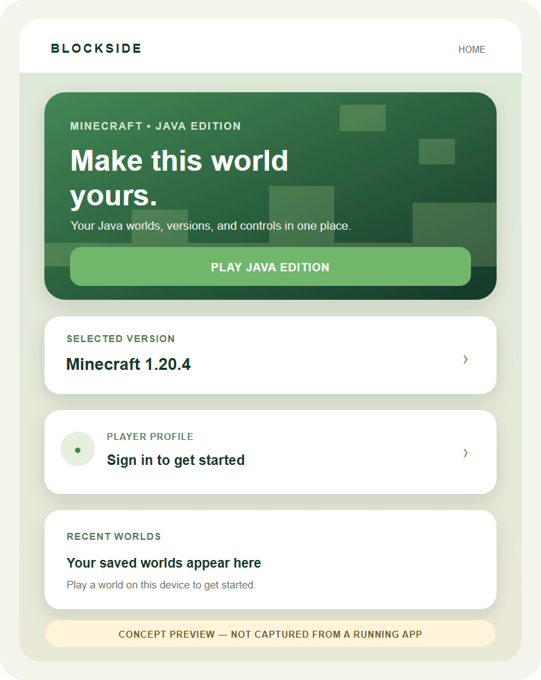
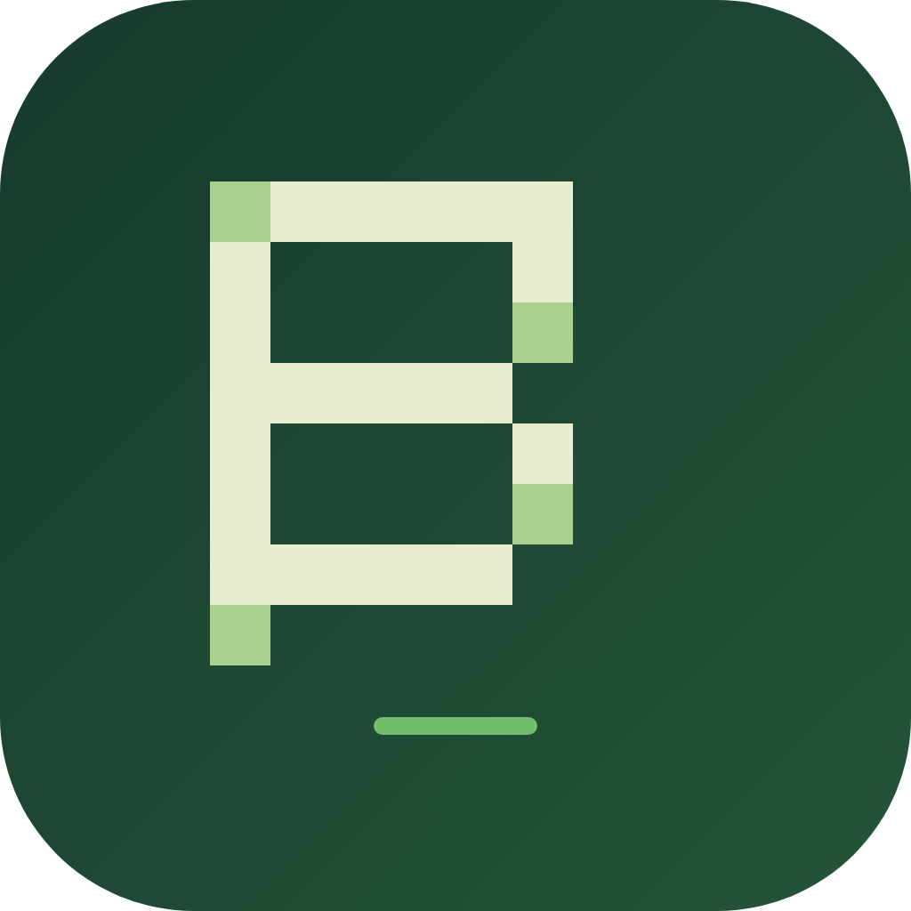

# Blockside

**A custom iPhone and iPad launcher interface for Minecraft: Java Edition, built on the PojavLauncher iOS engine.** This project is an independent community build. It is not made, approved, or supported by Mojang or Microsoft.

> **Preview art:** the cover and gallery images are original concept illustrations, not screenshots captured from a running device. The IPA build itself is real and was produced by GitHub Actions.

## Download and install

1. Open [Releases](https://github.com/cop3465cy-dotcom/minecraft-launcher-ios-12-build/releases). A release appears after a version tag is pushed and the draft is published by a maintainer.
2. Download `Blockside-Java-Edition.ipa` to your iPhone or iPad.
3. Install it with a trusted sideloading app such as [AltStore Classic](https://altstore.io/). The sideloading app signs the IPA for your device; this project does not include an Apple signing certificate.
4. Follow the device-specific [installation guide](docs/INSTALL.md), then enable JIT using the Pojav iOS 12.2 instructions.

The latest automated build can also be downloaded from [GitHub Actions](https://github.com/cop3465cy-dotcom/minecraft-launcher-ios-12-build/actions) while signed in. It is an IPA for sideloading, **not an App Store download or one-tap OTA install**. See [Downloads and releases](docs/DOWNLOAD.md).

## What it runs

- **Launcher interface:** Blockside’s custom UIKit dashboard and branding.
- **Launcher engine:** the archived PojavLauncher iOS v2.2 project, modified and built as part of this repository.
- **Game installation:** Minecraft Java versions are downloaded by the launcher after the player signs in. Game files are not included in this repository or IPA.
- **Game engine:** the actual Minecraft Java client runs through the bundled iOS ARM64 Java and graphics stack. This is not a Java simulator or a native Mojang iOS game.

### Compatibility

- Minimum target: **iOS 12.2**. iOS 12.0 and 12.1 are not supported by this engine build.
- Bundled Java runtimes: **Java 8 and Java 17**. Minecraft versions needing Java 21 (including Java Edition 1.20.5 and later) are unsupported by this build.
- JIT is required for usable gameplay performance. The correct enablement method depends on iOS version, device, and sideload setup; see [JIT and compatibility](docs/COMPATIBILITY.md).
- Older devices can have limited RAM, graphics support, and performance. Not every Java version, mod loader, server, or resource pack will work.

## Project gallery

These are original **concept previews**, not gameplay or device screenshots. Capture real screenshots from a running build before presenting them as product screenshots.

| Dashboard preview | App icon |
| --- | --- |
|  |  |

## Guides

- [Install on iPhone or iPad](docs/INSTALL.md)
- [Download builds and releases](docs/DOWNLOAD.md)
- [Compatibility, JIT, and known limitations](docs/COMPATIBILITY.md)
- [Build from source](docs/BUILD.md)
- [Publish a release and project site](docs/PUBLISHING.md)
- [Frequently asked questions](docs/FAQ.md)
- [Screenshot and media notes](docs/MEDIA.md)
- [Release notes template](docs/RELEASE_NOTES_TEMPLATE.md)
- [Project website source](docs/index.html)

## Build

The real device IPA is built by [`.github/workflows/ios-build.yml`](.github/workflows/ios-build.yml) on macOS. See [Build from source](docs/BUILD.md) for requirements and commands. The root `Blockside/` Xcode project is an earlier interface prototype; the active app and engine source are under `Engine/PojavLegacy/`.

## Licensing and attribution

The launcher is derived from PojavLauncher iOS v2.2 (commit `d9877bc423a4a66124f79e7403779652685ace2c`) and distributed under **GPL-3.0**. Source changes, upstream notices, and third-party license references are retained under [`Engine/PojavLegacy/`](Engine/PojavLegacy/); see also [`BLOCKSIDE-CHANGES.md`](Engine/PojavLegacy/BLOCKSIDE-CHANGES.md). The corresponding source must accompany distributed binaries. The original Blockside name and artwork do not imply affiliation with Mojang or Microsoft.

## Status

This is a legacy-compatible community launcher build, not an official Minecraft product. The CI build has completed, but gameplay has not been verified on a physical device. Read [the limitations](docs/COMPATIBILITY.md) before installing.
